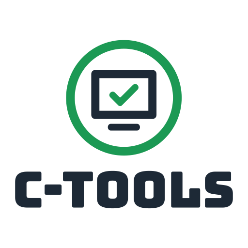

<section class="ct-hero">
  

    

      Java ORM Code Generator
      <h1 class="ct-hero-title">C-Tools</h1>
      

        Generate POJO, DAL, Service, Controller and more from database tables using JDBC / R2DBC standards.
      

      

        <a class="ct-protocol" href="/en-US/guide/getting-started#jdbc">
          
          JDBC
        </a>
        <a class="ct-protocol" href="/en-US/guide/getting-started#r2dbc">
          
          R2DBC
        </a>
      

      

        <a class="ct-btn ct-btn-primary" href="/en-US/guide/getting-started">Quick start</a>
        <a class="ct-btn ct-btn-ghost" href="https://github.com/yujiaao/c-tools" target="_blank" rel="noopener noreferrer">GitHub</a>
      

    

    

      
    

  

</section>

<section class="ct-features">
  

    <article class="ct-feature">
      <h3>Multi-protocol</h3>
      
Generate JDBC and R2DBC (Project Reactor) code from one configuration

    </article>
    <article class="ct-feature">
      <h3>Code generation</h3>
      
Auto-generate POJO, DAL, Service, Controller from database metadata

    </article>
    <article class="ct-feature">
      <h3>Incremental update</h3>
      
Compare schema cache and regenerate only changed tables

    </article>
    <article class="ct-feature">
      <h3>Multi-database</h3>
      
MySQL, PostgreSQL, Oracle, SQL Server and more

    </article>
    <article class="ct-feature">
      <h3>Read-write split</h3>
      
Application-level read-write separation and field encryption

    </article>
    <article class="ct-feature">
      <h3>Lightweight</h3>
      
No dependency on Hibernate or MyBatis

    </article>
  

</section>

<footer class="ct-footer">
  

    

      <h4>Community</h4>
      <a href="https://github.com/yujiaao/c-tools" target="_blank" rel="noopener noreferrer">GitHub</a>
    

    

      <h4>Help</h4>
      <a href="https://github.com/yujiaao/c-tools/issues" target="_blank" rel="noopener noreferrer">Feedback</a>
    

    

      <h4>Docs</h4>
      <a href="/en-US/guide/getting-started">Quick start</a>
      <a href="/en-US/guide/configuration">Configuration</a>
      <a href="/en-US/guide/faq">FAQ</a>
    

  

  
Apache License 2.0 · Copyright © 2019-present

</footer>
