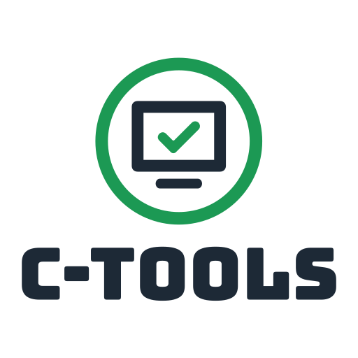

<section class="ct-hero">
  

    

      Java ORM 代码生成工具
      <h1 class="ct-hero-title">C-Tools</h1>
      

        基于 JDBC / R2DBC 标准，从数据库表自动生成 POJO、DAL、Service、Controller 等分层代码。
      

      

        <a class="ct-protocol" href="/guide/getting-started#jdbc">
          
          JDBC
        </a>
        <a class="ct-protocol" href="/guide/getting-started#r2dbc">
          
          R2DBC
        </a>
      

      

        <a class="ct-btn ct-btn-primary" href="/guide/getting-started">快速开始</a>
        <a class="ct-btn ct-btn-ghost" href="https://github.com/yujiaao/c-tools" target="_blank" rel="noopener noreferrer">GitHub</a>
      

    

    

      
    

  

</section>

<section class="ct-features">
  

    <article class="ct-feature">
      <h3>多协议支持</h3>
      
同一套配置即可生成 JDBC 与 R2DBC（Project Reactor）代码

    </article>
    <article class="ct-feature">
      <h3>代码生成</h3>
      
从数据库元信息自动生成 POJO、DAL、Service、Controller

    </article>
    <article class="ct-feature">
      <h3>增量更新</h3>
      
对比 schema 缓存，仅对变更表重新生成，避免覆盖手写逻辑

    </article>
    <article class="ct-feature">
      <h3>多数据库</h3>
      
支持 MySQL、PostgreSQL、Oracle、SQL Server 等主流数据库

    </article>
    <article class="ct-feature">
      <h3>读写分离</h3>
      
通过配置实现应用层读写分离与字段加解密

    </article>
    <article class="ct-feature">
      <h3>轻量级</h3>
      
不依赖 Hibernate、MyBatis 等重型 ORM 框架

    </article>
  

</section>

<footer class="ct-footer">
  

    

      <h4>社区</h4>
      <a href="https://github.com/yujiaao/c-tools" target="_blank" rel="noopener noreferrer">GitHub</a>
    

    

      <h4>帮助</h4>
      <a href="https://github.com/yujiaao/c-tools/issues" target="_blank" rel="noopener noreferrer">反馈问题</a>
    

    

      <h4>文档</h4>
      <a href="/guide/getting-started">快速开始</a>
      <a href="/guide/configuration">配置说明</a>
      <a href="/guide/faq">常见问题</a>
    

  

  
Apache License 2.0 · Copyright © 2019-present

</footer>
